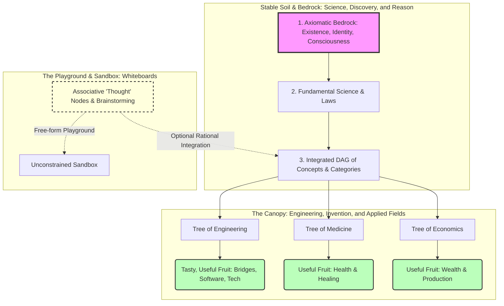

# Science, Discovery, and Reason: The Epistemological Architecture of Semantic Holograms

> **Status:** IDEA — metaphor. Wave 2026-09-27. Its diagram uses its own numbering, not the DAG ladder (see [`dag-layer-rules.md`](../core/dag-layer-rules.md)). See [`docs/README.md`](../README.md).

## Introduction
The Obsidian Semantic Hologram plugin is not merely a note-taking tool or a strict database; it is structured around a rigorous epistemology. Understanding this structure helps explain why the system is built the way it is, how it handles truth and validity, and how much freedom you have to explore, brainstorm, and invent.

---

## 1. The Bedrock and the Soil: Science and Discovery
At the core of the system is the **Directed Acyclic Graph (DAG)**:
- **The Floor (Bedrock):** Percepts, raw data, and evidence notes (`source`, `authority`, `data`) anchor the entire system in objective reality. Without this base, knowledge floats disconnectedly.
- **The Trunk & Soil:** Integrated concepts, categories, and universal principles form the fertile soil and trunk of the knowledge structure. This represents **science and discovery**—uncovering objective truths and tracing every concept down to its perceptual roots.

---

## 2. Trees and Fruit: Engineering and Invention
Just as fundamental science provides the stable soil, **applied disciplines and invention (engineering, art, architecture, software design)** act as independent trees planted in that soil:
- They draw their validity, constraints, and nourishment directly from the fundamental DAG.
- They yield practical, functional "fruit" (technology, projects, frameworks, systems) without altering or mutating the fundamental philosophy beneath them.
- **Multiple convergence:** Just as real-world inventions synthesize principles from disparate scientific fields, the DAG allows branches to join (multiple incoming edges) when higher-level integrations are discovered.

---

## 3. The Periphery: Whiteboards and "Thought" Nodes
Human thought is rarely clean, linear, or fully integrated from the start. To accommodate this, the system provides **`thought` nodes**:
- They act as a Zettelkasten whiteboard or staging ground for raw, unwashed brainstorming.
- They are free from strict DAG level constraints or mandatory evidence requirements.
- They allow you to capture associations and spot patterns freely, with the *option* of eventually integrating them into the rigorous DAG structure when they are ready—without forcing rigid structure onto casual ideation.

---

## 4. The Danger of Floating Abstractions
An architecture built on "floating abstractions" (castles in the air with no connection to perceptual reality) may look internally consistent, but it cannot support real weight. Anything grown from floating abstractions eventually collapses because it lacks an anchor in the facts of reality.

---

## 5. The Complete Epistemological Arc: From Concrete to Abstract, and Back to Concrete
True productivity and invention require understanding the full bidirectional flow of reason:

1. **Concrete to Abstract (Induction / Science):** 
   Starting from the objective concretes of perceptual reality, observing facts, and integrating them upward through structured concepts until you reach foundational universals and principles.
2. **Abstract to Concrete (Deduction / Invention / Engineering):** 
   Taking those established universal principles and traversing back down from the abstract to create tangible, real-world technology, systems, and artifacts.
3. **The Unbroken Cycle:** 
   From concrete to abstract, and back down to concrete—all grounded in objective reality, governed by reason, and rigorously integrated. This is the blueprint for both understanding the world and remaking it.

---

## Summary: How to Navigate the System
- **Build on Bedrock:** Ground your core principles in objective reality.
- **Plant in Fertile Soil:** Integrate your knowledge so it bears real, actionable fruit.
- **Play in the Sand:** Use `thought` nodes and unconstrained spaces as a sandbox for imagination and brainstorming, enjoying complete creative freedom without compromising rigor.

---

## Visual Architecture

