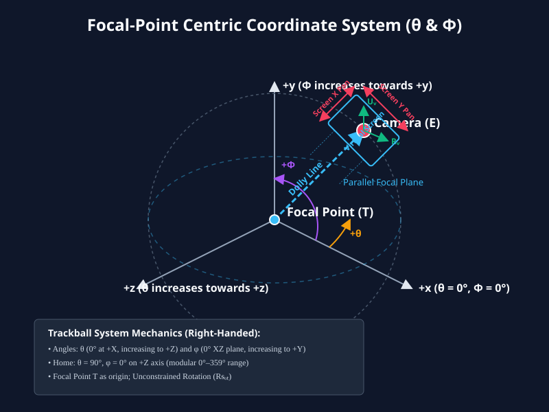

# Untethered Trackball Camera System with Orthographic Projection

## 1. Introduction and Core Concept

The **Untethered Trackball Camera System with Orthographic Projection** is the camera model used by the Semantic Hologram graph. It is a **rigid two-part assembly** — a camera eye and a focal point, locked at a constant separation — that moves through a fixed 3D world without ever distorting it.

It unifies four principles:

1. **Orthographic Projection & Virtual Screen.** Rays are parallel; there is no perspective division anywhere in the projection path. A bounded 2D virtual screen maps linearly to world space.
2. **Two Reference Frames.** Every quantity in this document is either expressed in **world space** or in the **focal-point / camera / virtual-screen frame**. Section 3 makes this distinction explicit, because most of the subtlety of the system lives there.
3. **Rigid-Rig Dolly.** The stand-off distance $R$ between eye $E$ and focal point $T$ is the *only* magnitude the user can change, and it changes the **magnification**, not the geometry. It is driven exclusively by the camera assembly travelling along the line of sight.
4. **Parallel Screen-Plane Panning.** The virtual screen, the eye, and the focal point translate rigidly together along the virtual screen's local $R_v$ and $U_v$ axes.

**There is no "orbit camera system in this document.** There are no orbits, no swivel about a target, no `orbitControls`, no azimuthal arc around a polar axis, and no concept of a camera "circling" a scene. Every rotational operation in this model is a **rotation of the assembly's orientation about its own focal point**, expressed directly as the angles $\theta$ and $\Phi$ defined in Section 6.

---

## 2. The Two Reference Frames

### 2.1 World Space Frame

A fixed, right-handed Cartesian frame that never moves:

| Axis | Direction |
| --- | --- |
| $+X$ | Right |
| $+Y$ | Up |
| $+Z$ | Out of the screen, toward the user |
| $-Z$ | Into the screen, away from the user |

All scene objects — nodes, edges, their radii, their velocities — live permanently in world space. **Their world coordinates are immutable during navigation.**

### 2.2 Focal-Point / Camera / Virtual-Screen Frame

A frame that travels *with* the camera assembly. It consists of three mutually orthogonal unit vectors:

* **$R_v$ — Virtual-Screen Right.** Where the virtual screen's right edge lies in world space.
* **$U_v$ — Virtual-Screen Up.** Where the virtual screen's top edge lies in world space.
* **$F$ — Forward (line of sight).** The direction the camera looks, and the direction of the line of sight.

Plus one position and one magnitude: the focal point $T$, and the standoff distance $R$. The camera eye $E$ is not independent state — it is always derived as $E = T - R\,F$ (Section 10.1), which is what guarantees the two halves of the assembly can never separate.

The virtual screen is a finite 2D rectangle centred on the eye $E$ and oriented by $(R_v, U_v, F)$. It is **always exactly the same size as the canvas** — one virtual-screen unit maps to one canvas pixel at a scale factor of 1, and the screen's extent is whatever the canvas currently is. Its local axes are $+x$ right and $+y$ **up**, which is the mirror of the canvas, where $+y$ points down.

> **The single most important consequence of the two-frame split:** *world space is where things are; the focal/camera frame is where the user is looking from.* Navigation moves the second. It never moves the first.

---

## 3. What Moves and What Does Not

This section answers, once and for all, what a navigation gesture does in each frame.

| | World Space Frame | Screen Frame (what you see) |
| --- | --- | --- |
| Scene objects (nodes, edges) | **Never move.** Fixed $(X, Y, Z)$ forever. | Slide, rescale, resize |
| Focal point $T$ | **Moves.** This is the one thing in world space that navigation touches. | Stays at screen centre |
| Camera eye $E$ | **Moves**, rigidly locked to $T$. | Stays at screen centre |
| Orientation $(R_v, U_v, F)$ | Changes on rotation only | Scene appears to tumble |
| Standoff $R$ | Changes on dolly only | Magnification changes |

**One object in world space moves: the camera/focal-point assembly.** Everything else in world space is scenery.

---

## 4. Panning — 2 Degrees of Freedom, 3 Dimensions of Motion

Panning is a **grab-the-world** gesture: you grab the scene and pull it. The scene tracks your cursor 1:1 on screen, and the assembly does the travelling.

### 4.1 The rule

Given a screen-space drag $\Delta x_{screen}$ (positive rightward) and $\Delta y_{screen}$ (positive downward, matching canvas pixel convention):

$$\Delta T = -S \cdot \left(\Delta x_{screen} \cdot R_v + \Delta y_{screen} \cdot U_v\right)$$

$$T_{new} = T_{old} + \Delta T \qquad E_{new} = E_{old} + \Delta T$$

The sign is negative because the camera moves *against* the content: drag the background right and the content follows the cursor rightward, which means the assembly moved leftward relative to the scenery.

### 4.2 The plane constraint — how 2DOF moves in 3D

The displacement $\Delta T$ is a combination of two basis vectors, so it is confined to a **2D plane**. That plane is parallel to the virtual screen and passes through the focal point. Its normal is $F$:

$$F \cdot \Delta T = 0$$

**There is zero motion along the line of sight.** Panning never dollies, and dollying never pans. The two operations are geometrically independent and exactly orthogonal.

Component-wise, a single screen axis generally drives all three world coordinates at once:

$$\begin{aligned} \Delta T_x &= -S\left(\Delta x_{screen} R_{v,x} + \Delta y_{screen} U_{v,x}\right) \\
\Delta T_y &= -S\left(\Delta x_{screen} R_{v,y} + \Delta y_{screen} U_{v,y}\right) \\
\Delta T_z &= -S\left(\Delta x_{screen} R_{v,z} + \Delta y_{screen} U_{v,z}\right)
\end{aligned}$$

### 4.3 Concrete cases

* **Drag background right.** Content moves right on screen. The assembly translates along $-R_v$.
  * *At home:* $R_v = +X$, so $T$ moves along $-X$ in world space.
  * *Rotated 90° so the camera looks along world $X$:* $R_v$ now points along world $Z$, so a purely horizontal screen drag moves $T$ along world $Z$.
  * *At an arbitrary $(\theta, \Phi)$:* $T$ slides across a tilted plane, generally changing $T_x$, $T_y$ and $T_z$ simultaneously.

* **Drag background down.** Content moves down on screen. The assembly translates along $-U_v$.
  * *At home:* $U_v = +Y$, so $T$ moves along $-Y$.
  * *Elsewhere:* $T$ moves along whatever world direction $U_v$ currently points.

* **Arrow keys (no Shift).** Identical to a drag, in direction and sign — the keyboard is a discrete feed into the same equation. `ArrowRight` pans the content right; `ArrowLeft` pans left; `ArrowUp` pans content up; `ArrowDown` pans content down. Panning speed is expressed in screen pixels, so it is divided by the current projection scale to obtain world units.

### 4.4 What panning does *not* change

* $\theta$, $\Phi$ — no rotation whatsoever.
* $R$ — the standoff is invariant.
* Any object coordinate.

---

## 5. Dollying — The Only Magnification Control

### 5.1 There is no zoom

The system has **no independent zoom control**. Magnification is not a free parameter the user sets. It is a *consequence* of the standoff distance $R$, and the user changes it only by travelling the assembly along the line of sight.

This is the defining choice of the model, and it is deliberate:

> Under a true orthographic projection, travelling closer does **not** change apparent size. So if dollying were the only lever, nothing would visibly happen. The system therefore makes $R$ a **magnification dial**: the projection scale is derived from the standoff distance, and the dolly is the input.

### 5.2 The scale–dolly relation

$$S = S_{base} \cdot \frac{R_{base}}{R}$$

where $R_{base}$ and $S_{base}$ are the home values. Magnification is therefore $R_{base} / R$:

* **Dolly inward** ($R \downarrow$): magnification $\uparrow$ — the graph grows, filling more of the canvas.
* **Dolly outward** ($R \uparrow$): magnification $\downarrow$ — the graph shrinks, more of it fits.

### 5.3 The dolly operation

The camera eye is **never independently positioned**. It is a derived quantity — always $E = T - R \cdot F$ — so the rig can never drift out of assembly. A dolly therefore has exactly two steps:

1. **Travel the assembly along the line of sight.** For a signed change $d$ in the standoff distance:
   $$\Delta D = -d \cdot F \qquad T_{new} = T_{old} + \Delta D$$
2. **Re-derive $R$ and the eye.** $R_{new}$ is whatever the requested magnification implies, and $E$ is then recomputed from $E = T_{new} - R_{new} \cdot F$.

Magnifying makes $d < 0$, so $\Delta D$ points along $+F$: the focal point advances *deeper into* the graph, closing on what you are inspecting, rather than retreating out of it. Orientation is untouched throughout.

### 5.4 Zoom is always centred on the camera

The dolly is a pure translation along $F$. Because $F$ is orthogonal to the screen plane, the screen-centre point does not move at all — only the magnification about it changes. Consequently:

* **The magnification centre is always the focal point**, which is always at screen centre.
* **There is no zoom-to-cursor.** The cursor position is irrelevant to the result and must not influence $T$.
* **There is no screen-plane compensation.** After a dolly, $T$ moves along $F$ only; its in-plane position is unchanged.

The standoff $R$ is **unbounded**: the dolly must run forward and back without limit, so no legal-range clamp is applied (the `dollyMin`/`dollyMax` bounds were removed 2026-10-01). The only guard is degenerate-state — a non-finite or underflowed-to-$\le 0$ $R$ is rejected, since it would make the projection scale $base/R$ infinite. $T$ is likewise deliberately **not** clamped. Clamping it cannot achieve the goal such a clamp would appear to serve, because a dolly moves $T$ along $F$ and $R_v \perp F$, so $R_v \cdot \Delta T = 0$ and the projected scene is invariant under travel: there is no direction in which the graph could be walked out of view. A per-axis clamp on $T$ is actively harmful. Once engaged it pins $T$ while $R$ continues to change, so magnification alters with no accompanying travel — a scale about a *different* point than the focal point, which is precisely the zoom 5.4 forbids, and the focal point silently drifts as the scene rescales beneath it. Neither $T$ nor $R$ is clamped; only the degenerate-state guard above applies.

$D$ accumulates onto the existing $T$; it must not be assigned. Since each dolly contributes $\Delta T = -\Delta D \cdot F$, a panned focal point must keep its pan while dollying. Assigning instead of accumulating discards the pan on the first wheel event.

### 5.5 Scroll-wheel dispatch

* **Cursor over a node:** the wheel adjusts the maximum hover depth, not the camera. Camera state is untouched.
* **Cursor over background:** the wheel dollies, per 5.3–5.4.

The `+` / `−` camera buttons issue the same dolly in fixed increments and are not zoom controls in any other sense. They are named **Magnify** / **Demagnify** rather than "Zoom In" / "Zoom Out", since magnification is the observable effect in both modes while the underlying mechanism differs: a dolly along the line of sight in 3D, a scale about the canvas centre in 2D. Their tooltips state which mechanism is active. The `+` / `−` glyphs and command IDs are unchanged.

---

## 6. Rotation — About the Focal Point

### 6.1 The anchor is $T$, never the world origin

**All rotation is about the focal point $T$.** The world-space origin plays no part in camera navigation. The assembly is not swung around the scene; it turns about its own centre of inspection.

Because $T$ is held fixed and $E = T - R\,F$ is derived from the orientation, rotating the basis makes the eye sweep a sphere of radius $R$ centred on $T$. The world origin may be anywhere at all relative to the assembly — $R_v$, $U_v$ and $F$ are all defined in world coordinates, but their *common anchor* is $T$.

### 6.2 Shift-drag

A shift-drag (or middle-button drag) rotates the assembly by accumulating incremental rotation matrices:

$$R_{rot} \leftarrow R_{\Delta} \cdot R_{rot}$$

followed by re-orthonormalisation to prevent numerical drift. The accumulated transform is applied to the basis, never to world positions, so $T$ and every scene object are untouched.

* **Shift-drag left** turns the assembly so the scene appears to rotate rightward on screen, dragging the viewpoint around toward the assembly's left-hand side.
* **Shift-drag right** is the mirror of this.
* Vertical shift-drag components tilt through the elevation angle $\Phi$.

Because rotation is applied incrementally to the local frame rather than integrated against a world pole, there are **no clamps, no polar singularities, and no gimbal lock**. The assembly may tumble the full $360^\circ$ and may pass through upside-down orientations.

### 6.3 Shift-arrow keys drive $\theta$ and $\Phi$ directly

The keyboard does not synthesise an incremental rotation — it steps the two angles of Section 7, which is what makes keyboard and drag navigation provably consistent.

| Key | Effect |
| --- | --- |
| `Shift` + `ArrowLeft` | **Decrease $\theta$** |
| `Shift` + `ArrowRight` | Increase $\theta$ |
| `Shift` + `ArrowUp` | **Decrease $\Phi$** |
| `Shift` + `ArrowDown` | Increase $\Phi$ |

Both angles wrap modulo $360^\circ$, so they may pass $0^\circ$ and continue upward, or pass $360^\circ$ and continue downward. No clamp, no singularity at the wrap point.

### 6.4 What rotation does *not* change

* $T$ — the focal point stays exactly where it is.
* $R$ — the standoff is invariant.
* Any object coordinate.

---

## 7. Angular State Representation

### 7.1 Angle definitions

Both angles are measured **relative to the focal point**, not relative to the world origin, and both are stored modulo $360^\circ$ in the range $0^\circ \le \text{angle} < 360^\circ$. No negative values are stored or accepted.

**Azimuth ($\theta$) — the horizontal swing.**
$\theta$ is the azimuth of the eye-offset direction $T \to E$ (equivalently $-F$) measured in the **focal point's** $XZ$ plane. It is $0^\circ$ when the eye offset points along the focal point's $+X$, and increases toward the focal point's $+Z$ when viewed from above (from $+Y$ down). **At home, $\theta = 90^\circ$.**

**Elevation ($\Phi$) — the vertical tilt.**
$\Phi$ is the elevation of the forward vector $F$. It is $0^\circ$ when $F$ lies in the focal point's $XZ$ plane, and increases as $F$ tilts toward the focal point's $+Y$. **At home, $\Phi = 0^\circ$.**

Geometrically, **$\Phi$ is a rotation in the vertical plane that contains the focal point's $+Y$ axis**, measured from the focal point's $XZ$ plane. That plane is spanned by $\hat h(\theta)$ and $+Y$, and $F$ always lies within it. Concretely $F = -\cos\Phi\,\hat h(\theta) + \sin\Phi\,(+Y)$, so $F$ is a fixed linear combination of those two vectors. This is exactly what makes $\Phi$ a rotation about the horizontal axis $\mathbf{R}_v$ in the Rodrigues sense, $d\mathbf{F}/d\Phi = \mathbf{R}_v \times \mathbf{F}$.

$\Phi$ positions the plane in which the eye offset swings; $\theta$ rotates that plane about the focal point's $Y$ axis. They are the only two angular degrees of freedom, and together with $T$ and $R$ they fully determine the camera.

> **Note on the axis.** Both $\Phi$ and $\theta$ are anchored on the **focal point** $T$, never the world origin. The *planes* of rotation are the focal point's own $XZ$ and vertical planes; they are not re-parented to the origin when $T$ moves, because rotating a plane through a translated point is the same rotation as through the origin once the centre of rotation is $T$ itself.

<div align="center">



</div>

### 7.2 Reading the angles from the orientation matrix

$$\theta = \operatorname{atan2}\!\left(R_{v,x},\ -R_{v,z}\right) \pmod{360^\circ}$$
$$\Phi = \operatorname{atan2}\!\left(F_y,\ -\mathbf{F}\cdot\hat{h}(\theta)\right) \pmod{360^\circ}$$

where $\hat{h}(\theta) = (\cos\theta, 0, \sin\theta)$ is the horizontal unit direction at the recovered $\theta$.

**$\theta$ must be read from row 1, not from $F$.** This is not a stylistic choice — reading it from $F$ is genuinely wrong, not merely fragile. From 7.3, $F = (-\cos\Phi\cos\theta, \sin\Phi, -\cos\Phi\sin\theta)$, so $F$ depends on $\cos\Phi$ as well as $\theta$. The map $(\theta,\Phi) \mapsto F$ is therefore **two-to-one**: for $\Phi \in (90^\circ, 270^\circ)$ the pair $(\theta,\Phi)$ and $(\theta+180^\circ, 180^\circ-\Phi)$ produce the *same* $F$ with $\mathbf{U}_v$ negated. Any $\theta$ recovered from $F$ alone folds by $180^\circ$ in that band.

Row 1 is immune because $\mathbf{R}_v = (\sin\theta, 0, -\cos\theta)$ is a function of $\theta$ **alone**, so it is exact at every $\Phi$ including the poles. Once $\theta$ is known, $\hat h(\theta)$ makes the $\Phi$ term unambiguous too: $\cos\Phi = -\mathbf{F}\cdot\hat h$ collapses to zero at $\Phi = \pm90^\circ$ and $\operatorname{atan2}$ returns exactly $90^\circ$ or $270^\circ$ with no special-case branch.

This makes the read-out an exact inverse of 7.3 over the full $0^\circ \le \Phi < 360^\circ$, which is what lets the keyboard, the sliders, and the on-screen read-out share one non-drifting state.

### 7.3 Rebuilding the basis from the angles

Given $\theta$ and $\Phi$ in radians:

$$\mathbf{F} = \left(-\cos\Phi\cos\theta,\ \ \sin\Phi,\ \ -\cos\Phi\sin\theta\right)$$

$$\mathbf{U}_v = \left(\sin\Phi\cos\theta,\ \ \cos\Phi,\ \ \sin\Phi\sin\theta\right) \qquad \mathbf{R}_v = \left(\sin\theta,\ 0,\ -\cos\theta\right)$$

This is exact rather than iterative: no cross products, no Gram-Schmidt, no accumulated error. Setting $\theta = 90^\circ$, $\Phi = 0^\circ$ reproduces the home basis exactly.

---

## 8. Home Position

Home is the canonical reset state.

$$T = (0,0,0) \qquad E = (0,0,R) \qquad \theta = 90^\circ \quad \Phi = 0^\circ$$

At home the basis aligns with the world axes: $R_v = +X$, $U_v = +Y$, and $F = (0,0,-1)$ — the camera sits on the $+Z$ axis looking straight into the screen.

### 8.1 The stored matrix and the canvas Y-flip

The implementation stores the orientation as three **rows**:

$$\mathbf{R}_{rot} = \begin{bmatrix} R_v \\ \tilde{U}_v \\ \mathbf{F} \end{bmatrix} \qquad \text{where } \tilde{U}_v = -\mathbf{U}_v$$

The up row is negated in storage. This is a canvas convenience and nothing more: because $\tilde U_v$ already points the other way, the screen mapping can stay a plain affine translate-and-scale with **no sign flip of its own**, and positive world $Y$ still projects upward on screen.

The negation is what keeps the stored matrix a proper rotation rather than a reflection. Because $\mathbf{R}_v \times \tilde{\mathbf{U}}_v = \mathbf{F}$ in the stored form, $\det \mathbf{R}_{rot} = +1$, and the re-orthonormalisation step in Section 6.2 can reconstruct $F$ by cross product without ever being handed a sign error.

> Without this negation the basis $(\mathbf{R}_v, \mathbf{U}_v, \mathbf{F})$ would have $\det = -1$: looking down $-Z$ in a right-handed world makes the camera basis left-handed. The stored form sidesteps this and stays orthonormal.

### 8.2 Canvas-to-Cartesian reorientation

* Canvas: origin top-left, $+y$ **down**.
* World: origin at $(0,0,0)$, $+Y$ **up**.
* The virtual screen: centred on $E$, oriented by $(R_v, U_v, F)$, always matching the canvas dimensions, with local $+y$ **up**.

The mapping is a translation to the screen centre followed by a uniform scale $S$. There is no perspective division and no depth-dependent term.

---

## 9. Node Size vs. Distance

Node size and camera distance are **separate concerns**, and conflating them is the classic way a 3D graph becomes unreadable.

* **Geometry is size-invariant.** Under orthographic projection, a node's projected disc has a radius set by its world radius and the scale $S$ — nothing else. Depth $z$ contributes **nothing** to its projected radius. Dolly magnification changes $S$, so it changes node size exactly as it changes edge length and label offset, preserving the drawing's proportions.

* **Depth is expressed as a visual cue only.** The rotated depth $z$ of a node relative to $T$ drives label font size and label opacity. Nodes nearer the camera get larger, more opaque labels; nodes further away get smaller, fainter ones. This is a deliberate perceptual aid layered on top of a projection that is otherwise depth-blind.

* **Dolly interacts with the depth cue, not the geometry.** As the assembly travels, nodes cross the focal plane and their relative depths change, so the label cues re-evaluate continuously. A node you are closing in on brightens as it approaches the focal plane. This is the desired behaviour and is the reason the depth cue is expressed in relative depth rather than absolute.

**No perspective.** Depth-dependent size scaling would require a $1/z$ divide, which foreshortens labels near the canvas edges and breaks the legibility that makes a semantic graph a semantic graph. The model stays orthographic, and dolly-driven magnification is a uniform scale — never a perspective transform.

---

## 10. Mathematical Reference

### 10.1 Camera eye

$$E = T - R \cdot F$$

### 10.2 Panning

$$\Delta T = -S\left(\Delta x_{screen} \mathbf{R}_v + \Delta y_{screen} \mathbf{U}_v\right), \qquad F \cdot \Delta T = 0$$

$$T \leftarrow T + \Delta T, \qquad E \leftarrow E + \Delta T$$

### 10.3 Rotation

$$R_{rot} \leftarrow R_{\Delta} \cdot R_{rot}, \qquad R_{\Delta} = \operatorname{axisAngle}(\text{axis}, \delta)$$

followed by Gram-Schmidt re-orthonormalisation. $T$ is not an input to this operation.

### 10.4 Dolly

$$\Delta D = -d \cdot F, \qquad T \leftarrow T + \Delta D$$

$$R \leftarrow \operatorname{clamp}\!\left(\frac{R_{base}}{m},\; R_{min},\; R_{max}\right), \qquad E \leftarrow T - R \cdot F \quad\text{(re-derived)}$$

$$S \leftarrow S_{base} \cdot \frac{R_{base}}{R}$$

### 10.5 Reset

$$T = (0,0,0), \quad R_{rot} = \begin{bmatrix} 1 & 0 & 0 \\ 0 & -1 & 0 \\ 0 & 0 & -1 \end{bmatrix}, \quad \theta = 90^\circ, \Phi = 0^\circ, \quad R \leftarrow R_{base}$$

---

## 11. Reference Implementation Loop

```python
class UntetheredTrackballCameraOrthographic:
    def __init__(self, focal_point=(0, 0, 0), distance=1000.0, base_scale=1.0):
        self.T = vector(focal_point)          # focal point (world space)
        self.R = distance                      # standoff distance (the only magnitude)
        self.R_base = distance                 # home standoff
        self.S_base = base_scale               # home projection scale

        # Stored rows are [R_v, -U_v, F]: the up row is negated so the canvas
        # mapping needs no sign flip and det == +1.
        self.R_rot = matrix([
            [1, 0,  0],
            [0, -1, 0],
            [0, 0, -1],
        ])

    # ---- derived state -------------------------------------------------
    @property
    def right_v(self):  return row(self.R_rot, 0)
    @property
    def up_v(self):     return negate(row(self.R_rot, 1))   # true virtual-screen up
    @property
    def forward_v(self): return row(self.R_rot, 2)

    @property
    def scale(self):
        # Magnification is derived from standoff distance. No independent zoom.
        return self.S_base * (self.R_base / self.R)

    @property
    def eye(self):
        return self.T - self.R * self.forward_v

    # ---- 2DOF translation ----------------------------------------------
    def pan(self, dx_screen, dy_screen):
        """Grab-the-world. dx/dy are canvas pixels (y positive downward)."""
        delta = -self.scale * (dx_screen * self.right_v + dy_screen * self.up_v)
        self.T += delta          # eye follows rigidly; R and orientation invariant

    # ---- rotation, anchored at T ---------------------------------------
    def rotate_about_axis(self, axis, delta_rad):
        """Local-frame rotation. The world origin is never an anchor."""
        self.R_rot = matmul(axis_angle(axis, delta_rad), self.R_rot)
        self.R_rot = gram_schmidt(self.R_rot)   # R_v x (-U_v) == F, det == +1

    def set_angles(self, theta_deg, phi_deg):
        """Exact reconstruction; used by the Shift+arrow bindings."""
        th = radians(theta_deg % 360)
        ph = radians(phi_deg % 360)
        F = vector(-cos(ph) * cos(th), sin(ph), -cos(ph) * sin(th))
        U = vector(sin(ph) * cos(th), cos(ph), sin(ph) * sin(th))
        R = vector(sin(th), 0, -cos(th))
        self.R_rot = matrix([R, negate(U), F])

    def read_angles(self):
        F = self.forward_v
        # theta from row 1, which is a function of theta alone -- exact at all phi.
        R_v = self.R_rot[0]
        th = radians(degrees(atan2(R_v[0], -R_v[2])) % 360)
        h = vector(cos(th), 0.0, sin(th))   # horizontal ref at the recovered theta
        return (
            degrees(atan2(R_v[0], -R_v[2])) % 360,   # theta
            degrees(atan2(F[1], -dot(F, h))) % 360,  # phi
        )

    # ---- dolly (the only magnification control) -------------------------
    def dolly(self, magnification_factor):
        """Travel the assembly along the line of sight. Always centred on T.

        F is orthogonal to the screen plane, so T's screen position is invariant
        under this motion -- which is exactly why the magnification has to be
        centred on it. The eye is derived, never independently positioned.
        """
        prev = self.R
        nxt = clamp(prev / magnification_factor, dolly_min, dolly_max)
        d = nxt - prev
        self.T += -d * self.forward_v   # in-plane position of T is untouched
        self.R = nxt                   # E follows automatically as T - R * F

    def scroll(self, delta):
        self.dolly(exp(-delta * dolly_gain))

    # ---- reset ----------------------------------------------------------
    def reset_to_home(self):
        self.T = vector(0, 0, 0)
        self.R_rot = matrix([[1, 0, 0], [0, -1, 0], [0, 0, -1]])
        self.R = self.R_base
```

---

## 12. Invariant Summary

| Quantity | Pan | Rotate | Dolly | Reset |
| --- | --- | --- | --- | --- |
| Object world coords | fixed | fixed | fixed | fixed |
| $T$ | translates in screen plane | **fixed** | translates along $F$ | $(0,0,0)$ |
| $E$ | translates with $T$ | orbits $T$ | translates with $T$ | $(0,0,R)$ |
| $\theta$ | fixed | changes | fixed | $90^\circ$ |
| $\Phi$ | fixed | changes | fixed | $0^\circ$ |
| $R$ | fixed | fixed | **changes** | $R_{base}$ |
| $S$ | fixed | fixed | **derived from $R$** | $S_{base}$ |