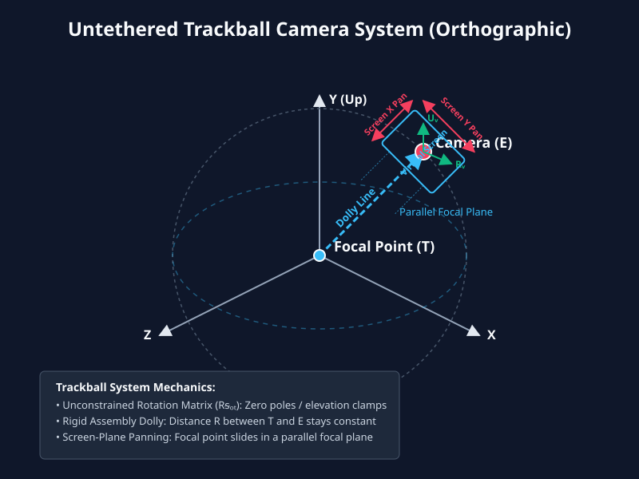

# Untethered Trackball Camera System with Orthographic Projection

## 1. Introduction and Core Concept

The **Untethered Trackball Camera System with Orthographic Projection** is an advanced 3D camera model designed for unconstrained technical visualization, CAD modeling, and spatial graph inspection. It unifies several key principles:
1. **Orthographic Projection & Virtual Screen:** Renders scenes with parallel rays (linearly mapped via view scale $S$ without perspective foreshortening) through a bounded 2D virtual screen surface positioned and oriented in 3D world space.
2. **Incremental Trackball / Arcball Rotation:** Replaces constrained Euler angles ($\theta, \phi$) with a pure 3D rotation matrix or quaternion ($R_{rot}$), completely removing polar singularities, gimbal lock, and elevation clamps ($\pm 89.4^\circ$), enabling seamless $360^\circ$ vertical tumbling and upside-down viewing.
3. **Rig Assembly Dolly (Replacing Traditional Zoom):** Instead of altering the stand-off radius between the camera and focal point, the camera eye ($E$) and focal point ($T$) are rigidly locked at a constant distance ($R$). Dollying moves the entire camera-focal assembly as a rigid unit forward or backward along the line of sight.
4. **Parallel Screen-Plane Panning:** Translates the virtual screen and focal point together along the local Right ($R_v$) and Up ($U_v$) axes of the virtual screen plane, shifting the focal point within a strictly parallel focal point plane in 3D world space.

---

## 2. Geometric State Representation

The camera assembly is defined by the following state variables:

* **Focal Point ($T$):** A 3D world coordinate $(T_x, T_y, T_z)$ serving as the anchor point around which inspection and navigation occur.
* **Camera Distance ($R$):** The constant Euclidean distance from the focal point to the camera eye position ($E$).
* **Orientation Matrix ($R_{rot}$):** A $3 \times 3$ rotation matrix representing the current angular orientation of the camera rig in world space, containing local Right ($R_v$), Up ($U_v$), and Forward ($F$) vectors.
* **Orthographic View Scale ($S$):** The half-width / zoom scale of the orthographic viewing volume.
* **Virtual Screen:** A finite 2D rectangular surface centered at the camera eye (or aligned with the viewing plane) in 3D space, mapping pixel coordinates linearly to world space.

<div align="center">



</div>

---

## 3. Core Interaction Mechanics

### A. Incremental Trackball Rotation
Applying user rotation deltas multiplies a delta rotation matrix into the orientation matrix ($R_{rot} = R_{delta} \times R_{rot}$). Because rotation is tracked incrementally relative to the camera's local frame rather than absolute world poles, there are zero clamps or singularities, permitting unconstrained $360^\circ$ tumbling.

### B. Parallel Screen-Plane Panning
Panning slides the virtual screen along its local Right ($R_v$) and Up ($U_v$) axes in 3D world space. Because the camera eye $E$ and focal point $T$ are rigidly locked, this simultaneously slides the focal point $T$ within a 3D plane strictly parallel to the virtual screen plane. The viewing angle and stand-off distance remain completely invariant.

### C. Rig Assembly Dolly (Constant-Distance Forward/Backward Movement)
Traditional perspective/orbit zoom alters the distance between the camera and the target. In this system, the stand-off distance ($R$) remains strictly fixed. Dollying translates both the camera eye $E$ and focal point $T$ simultaneously along the camera's Forward vector ($F$) as a rigid assembly, moving the viewpoint deeper into or out of the 3D world.

### D. Defined Home Position & Reset State
A designated reset configuration restoring the default orientation matrix (`defaultRotM`), default focal point (`[0, 0, 0]`), and default view scale ($S$), providing an instant snap-back to baseline framing.

### E. Select-Drag Interaction
Projecting 2D mouse drags onto a plane parallel to the virtual screen surface, translating selected 3D world objects' absolute coordinates in lockstep with the cursor using the camera's orientation matrix.

---

## 4. Mathematical Derivations and Transformations

### A. Camera Eye Position ($E$) Derivation
Given the focal point $T$, constant distance $R$, and the camera's local Forward vector ($F$) extracted from the orientation matrix ($R_{rot}$):
$$E = T - R \cdot F$$

### B. Screen-Plane Panning Derivation
Extracting local Right ($R_v$) and Up ($U_v$) vectors from $R_{rot}$:
$$\Delta X_{world} = - \Delta x_{screen} \cdot S \cdot R_v$$
$$\Delta Y_{world} = - \Delta y_{screen} \cdot S \cdot U_v$$
$$T_{new} = T_{old} + \Delta X_{world} + \Delta Y_{world}$$
$$E_{new} = E_{old} + \Delta X_{world} + \Delta Y_{world}$$

### C. Rig Assembly Dolly Derivation
To dolly forward or backward by delta amount $d$:
$$\Delta D_{world} = d \cdot F$$
$$T_{new} = T_{old} + \Delta D_{world}$$
$$E_{new} = E_{old} + \Delta D_{world}$$
*(Note: $R = |T - E|$ remains constant).*

---

## 5. Reference Implementation Update Loop (Pseudocode)

```python
class UntetheredTrackballCameraOrthographic:
    def __init__(self, focal_point=(0,0,0), distance=10.0, scale=5.0):
        self.T = vector(focal_point)
        self.R = distance
        self.S = scale
        self.R_rot = identity_matrix(3) # 3x3 orientation matrix (Right, Up, Forward)

    def update_trackball(self, delta_rotation_matrix):
        # Accumulate incremental rotation with zero pole limits
        self.R_rot = matrix_multiply(delta_rotation_matrix, self.R_rot)

    def update_pan(self, delta_x_screen, delta_y_screen):
        # Extract local Right and Up vectors from orientation matrix
        right_v = vector(self.R_rot[0][0], self.R_rot[1][0], self.R_rot[2][0])
        up_v = vector(self.R_rot[0][1], self.R_rot[1][1], self.R_rot[2][1])
        
        delta_world = -delta_x_screen * self.S * right_v - delta_y_screen * self.S * up_v
        self.T += delta_world
        # E translates with T automatically via E = T - R * F (rig assembly)

    def update_dolly(self, delta_distance):
        # Move entire camera-focal assembly along Forward vector (constant distance R)
        forward_v = vector(self.R_rot[0][2], self.R_rot[1][2], self.R_rot[2][2])
        delta_dolly = delta_distance * forward_v
        self.T += delta_dolly
        # E moves in lockstep

    def reset_to_home(self):
        self.T = vector(0, 0, 0)
        self.R_rot = identity_matrix(3)
        self.S = 5.0

    def compute_matrices(self):
        forward_v = vector(self.R_rot[0][2], self.R_rot[1][2], self.R_rot[2][2])
        up_v = vector(self.R_rot[0][1], self.R_rot[1][1], self.R_rot[2][1])
        E = self.T - self.R * forward_v

        view_matrix = look_at(E, self.T, up_v)
        proj_matrix = orthographic_projection(-self.S, self.S, -self.S/aspect, self.S/aspect, near, far)
        
        return view_matrix, proj_matrix
```
