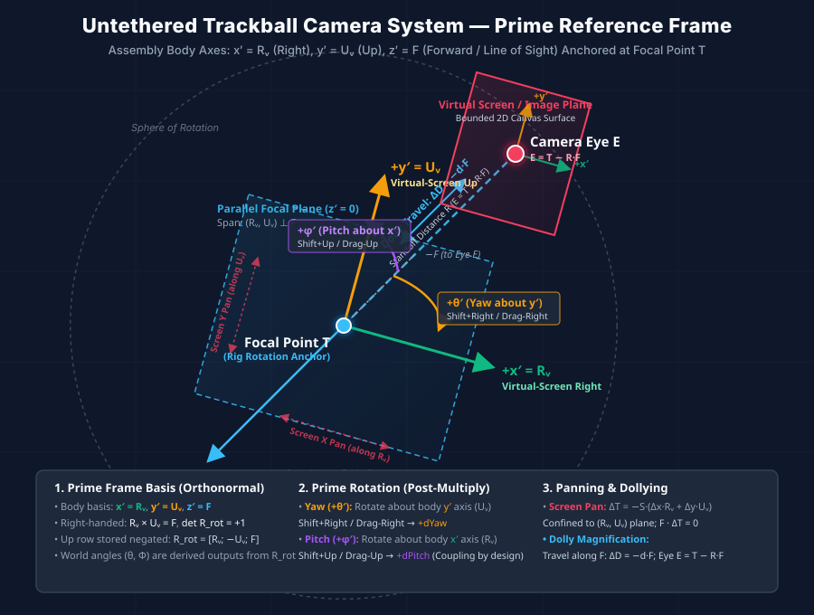

# Untethered Trackball Pinhole Camera System

## 1. Introduction and Core Concept

The **Untethered Trackball Pinhole Camera System** is the camera model used by the
Semantic Hologram graph. It is a **rigid two-part assembly** — a camera eye and a
focal point, locked at a constant separation — that moves through a fixed 3D world
without ever distorting it.

It unifies five principles:

1. **Pinhole projection by default.** The eye sits a fixed distance `d` in front of
   an image plane, and a point at view-frame depth `z` projects with the pinhole
   scale `s = d / (z + R)` (Section 4). An optional **orthographic** mode drops the
   depth term and projects with a single constant scale.
2. **A bounded virtual screen.** A finite 2D rectangle tracks the canvas and
   carries the projection; it is the surface the pinhole image lands on.
3. **Two reference frames.** Every quantity is expressed either in **world space**
   or in the **focal-point / camera / virtual-screen frame**. Section 3 makes this
   distinction explicit, because most of the subtlety of the system lives there.
4. **Rigid-rig dolly.** The stand-off distance `R` between eye `E` and focal point
   `T` is the *only* magnitude the user can change, and it changes the
   **magnification**, not the geometry. It is driven exclusively by the camera
   assembly travelling along the line of sight.
5. **Parallel screen-plane panning.** The virtual screen, the eye, and the focal
   point translate rigidly together along the virtual screen's local `R_v` and
   `U_v` axes.

**There is no orbit camera in this document.** There are no orbits, no swivel about
a target, no `orbitControls`, no azimuthal arc around a polar axis, and no concept
of a camera "circling" a scene. Rotation is a **trackball**: incremental rotations
of the assembly about its **own** body axes `x'` and `y'`, anchored on the focal
point `T`. The two world angles `θ` and `Φ` are *derived read-outs* of that
orientation, not the quantities the user drives directly (Section 7).

---

## 2. The Two Reference Frames

### 2.1 World Space Frame

A fixed, right-handed Cartesian frame that never moves:

| Axis | Direction |
| --- | --- |
| `+X` | Right |
| `+Y` | Up |
| `+Z` | Out of the screen, toward the user |
| `-Z` | Into the screen, away from the user |

All scene objects — nodes, edges, their radii, their velocities — live permanently
in world space. **Their world coordinates are immutable during navigation.**

### 2.2 Focal-Point / Camera / Virtual-Screen Frame



A frame that travels *with* the camera assembly. It consists of three mutually
orthogonal unit vectors:

* **`R_v` — Virtual-Screen Right.** Where the virtual screen's right edge lies in
  world space.
* **`U_v` — Virtual-Screen Up.** Where the virtual screen's top edge lies in world
  space.
* **`F` — Forward (line of sight).** The direction the camera looks, and the
  direction of the line of sight.

Plus one position and one magnitude: the focal point `T`, and the standoff distance
`R`. The camera eye `E` is not independent state — it is always derived as
`E = T - R·F` (Section 11.1), which is what guarantees the two halves of the
assembly can never separate.

The virtual screen is a finite 2D rectangle centred on the eye `E` and oriented by
`(R_v, U_v, F)`. It is **always exactly the same size as the canvas** — one
virtual-screen unit maps to one canvas pixel at the home scale — and its local axes
are `+x` right and `+y` **up**, the mirror of the canvas, where `+y` points down.

> **The single most important consequence of the two-frame split:** *world space is
> where things are; the focal/camera frame is where the user is looking from.*
> Navigation moves the second. It never moves the first.

The orientation is stored as three **rows**:

$$\mathbf{R}_{rot} = \begin{bmatrix} R_v \\ \tilde{U}_v \\ F \end{bmatrix}
\qquad \text{where } \tilde{U}_v = -U_v$$

The up row is negated in storage so the canvas mapping stays a plain affine
translate-and-scale (no sign flip of its own) while keeping
`det R_rot = +1` (Section 9.1).

---

## 3. What Moves and What Does Not

| | World Space Frame | Screen Frame (what you see) |
| --- | --- | --- |
| Scene objects (nodes, edges) | **Never move.** Fixed `(X, Y, Z)` forever. | Slide, rescale, resize |
| Focal point `T` | **Moves.** The one thing in world space that navigation touches. | Stays at screen centre |
| Camera eye `E` | **Moves**, rigidly locked to `T`. | Stays at screen centre |
| Orientation `(R_v, U_v, F)` | Changes on rotation only | Scene appears to tumble |
| Standoff `R` | Changes on dolly only | Magnification changes |

**One object in world space moves: the camera/focal-point assembly.** Everything
else in world space is scenery.

---

## 4. Projection — Pinhole (Perspective) and Orthographic

The plugin has **two** projection modes, toggled with `p` or by clicking the
projection banner (the second upper-left icon). **Perspective is the default.**

### 4.1 Pinhole (perspective) projection

The eye `E` and the image plane form a rigid assembly: the plane sits a **fixed**
distance `d = baseCameraDistance` in front of the eye, and the whole assembly
stands off the focal point by `R` along `F`. For a point whose view-frame depth is

$$z = F \cdot (p - T)$$

the screen scale is the true pinhole ratio

$$s(z) = \frac{d}{z + R}$$

so a point projects to `screen = centre + (x₂, y₂)·s(z)`, where `(x₂, y₂)` are the
point's view-frame right/up coordinates. At the focal plane `z = 0` this equals
`s = d/R = viewScale`, so the two modes **coincide at the focal point**. There is no
injected scale factor and no "zoom" term: magnification is a pure function of
position.

Two guards protect the pinhole singularity:

* **`PERSP_NEAR = 1`** — a denominator `z + R ≤ 1` means the point is at or behind
  the eye; it is treated as off-camera (its scale is `NaN` and the point is skipped).
* **`PERSP_STANDOFF_MIN = 50`** — under perspective only, `R` is floored at 50 so
  the denominator at the focal plane cannot reach the near singularity. This is a
  **projection guard, not a magnification clamp**; it must not be applied to the
  orthographic path or extended into a general dolly bound.

### 4.2 Orthographic projection

Orthographic drops the depth term and uses a single constant scale:

$$s = viewScale = \frac{baseCameraDistance}{R}$$

Depth then drives **label size and opacity only**, never projected geometry. This is
the original, depth-blind model.

### 4.3 Toggling

`p` (or the banner icon) switches between `perspective` and `orthographic`. The modes
share every other part of the rig — `T`, `R`, the orientation, and all navigation.
Switching mode changes only how a point's view-frame coordinates become pixels.

### 4.4 Depth and node size

* **Geometry (orthographic).** A node's projected disc radius is set by its world
  radius and the scale `s` — depth contributes nothing. Dolly magnification changes
  `s` exactly as it changes edge length and label offset, preserving proportions.
* **Geometry (perspective).** A node's projected disc and label scale by `s(z)`, so
  nearer nodes are genuinely larger. This is the pinhole divide, not a stylistic
  cue.
* **Cues (both).** Rotated depth relative to `T` drives label font size and opacity
  in orthographic mode, and re-evaluates continuously as the assembly travels.

---

## 5. Panning — 2 Degrees of Freedom, 3 Dimensions of Motion

Panning is a **grab-the-world** gesture: you grab the scene and pull it. The scene
tracks your cursor 1:1 on screen, and the assembly does the travelling.

Given a screen-space drag `Δx_screen` (positive rightward) and `Δy_screen` (positive
downward, matching canvas pixel convention):

$$\Delta T = -S \cdot \left(\Delta x_{screen} \cdot R_v + \Delta y_{screen} \cdot U_v\right)$$

$$T_{new} = T_{old} + \Delta T \qquad E_{new} = E_{old} + \Delta T$$

The sign is negative because the camera moves *against* the content. The
displacement is confined to a **2D plane** parallel to the virtual screen and
passing through `T`, whose normal is `F`:

$$F \cdot \Delta T = 0$$

**There is zero motion along the line of sight.** Panning never dollies, and
dollying never pans. Panning leaves `θ`, `Φ`, `R`, and every object coordinate
untouched.

**Arrow keys (no Shift)** feed the same equation discretely: `ArrowRight` pans the
content right, `ArrowLeft` left, `ArrowUp` up, `ArrowDown` down. Panning speed is
expressed in screen pixels and divided by the current projection scale to obtain
world units.

---

## 6. Dollying — The Only Magnification Control

### 6.1 There is no zoom

The system has **no independent zoom control**. Magnification is not a free
parameter the user sets; it is a *consequence* of the standoff distance `R`, and the
user changes it only by travelling the assembly along the line of sight. Because the
projection scale is `base/R` (both modes, up to the focal-plane coincidence), `R` is
effectively a **magnification dial** and the dolly is the input.

### 6.2 The dolly operation

The camera eye is **never independently positioned**; it is always `E = T - R·F`. A
dolly has two steps:

1. **Travel the assembly along the line of sight.** For a signed change `d` in the
   standoff:
   $$\Delta D = -d \cdot F, \qquad T_{new} = T_{old} + \Delta D$$
2. **Re-derive `R` and the eye.** `E = T_{new} - R_{new}·F`.

Magnifying makes `d < 0`, so `ΔD` points along `+F`: the focal point advances
*deeper into* the graph. Orientation is untouched throughout.

`T` **accumulates** its travel (`this.target[i] += …`); it is never assigned. A
panned focal point must keep its pan while dollying, and assigning instead of
accumulating discards the pan on the first wheel event.

### 6.3 Magnification is always centred on the focal point

The dolly is a pure translation along `F`. Because `F` is orthogonal to the screen
plane, the screen-centre point does not move at all — only the magnification about
it changes. Consequently:

* **The magnification centre is always the focal point**, which is at screen centre.
* **There is no zoom-to-cursor.** Cursor position is irrelevant and must not
  influence `T`.
* **There is no screen-plane compensation.** After a dolly, `T` moves along `F`
  only.

### 6.4 Unbounded standoff; no `T` clamp

The standoff `R` is **unbounded**: the dolly must run forward and back without
limit, so no `dollyMin`/`dollyMax` clamp applies (removed 2026-10-01). The only
guards are degenerate-state — a non-finite or underflowed-to-`≤ 0` `R` is rejected
(it would make the scale infinite) — and, under perspective, the near-plane floor
`PERSP_STANDOFF_MIN` of Section 4.1.

`T` is likewise deliberately **not** clamped. A dolly moves `T` along `F`, and
`R_v ⊥ F`, so `R_v · ΔT = 0` and the projected scene is invariant under travel:
there is no direction in which the graph could be walked out of view. A per-axis
clamp on `T` is actively harmful — once engaged it pins `T` while `R` keeps changing,
so magnification alters with no travel, a scale about a different point than the
focal point, which is precisely the forbidden zoom, and the focal point silently
drifts.

### 6.5 Scroll-wheel dispatch and controls

* **Cursor over a node:** the wheel adjusts the maximum hover depth, not the camera.
* **Cursor over background (plain scroll):** the wheel changes the standoff `R`
  (magnify / demagnify), centred on the focal point.
* **Shift + scroll:** dollies the assembly along the line of sight.

The `+` / `−` buttons (and `Ctrl+Shift+=` / `Ctrl+-`) issue the same magnification in
fixed increments and are not zoom controls in any other sense. They are named
**Magnify** / **Demagnify**, since magnification is the observable effect in both
modes while the mechanism differs (a dolly along the line of sight in 3D, a scale
about the canvas centre in 2D). Their tooltips state which mechanism is active; the
`+`/`−` glyphs and command IDs are unchanged.

---

## 7. Rotation — Prime-Frame Trackball

### 7.1 The anchor is `T`, never the world origin

**All rotation is about the focal point `T`.** The world origin plays no part in
camera navigation. Because `T` is held fixed and `E = T - R·F` is derived from the
orientation, rotating the basis makes the eye sweep a sphere of radius `R` centred
on `T`.

### 7.2 Rotation is prime-frame: `θ'` about `y'`, `φ'` about `x'`

The continuous rotation controls — `Shift`+arrow (`step()`) and `Shift`/middle
drag — call

```
applyRotationDeltas(dYaw, dPitch)
```

which **post-multiplies** the basis by a rotation of `θ'` about the assembly's own
`y'` (screen-vertical) axis, then `φ'` about its own `x'` (screen-right) axis:

$$\mathbf{R}_{rot} \leftarrow \mathbf{R}_{rot} \cdot \operatorname{Rot}(y',\, \theta') \cdot \operatorname{Rot}(x',\, \phi')$$

followed by re-orthonormalisation. The prime axes are the assembly's body axes; in
world space they are the rows of `rotM` (`x' = R_v`, `y' = -U_v` stored, `z' = F`).
We never rotate about `z'`, so the prime-frame roll stays zero.

**Signs:**

| Input | Delta |
| --- | --- |
| `Shift` + `ArrowRight`, drag right | `+θ'` |
| `Shift` + `ArrowLeft`, drag left | `-θ'` |
| `Shift` + `ArrowUp`, drag up | `+φ'` |
| `Shift` + `ArrowDown`, drag down | `-φ'` |

### 7.3 `θ` and `Φ` are derived, never driven

The world angles `θ` and `Φ` are **read back out of `rotM`** by
`updateAnglesFromMatrix` after every rotation. They are outputs, never inputs.

* **Do not implement manual rotation by calling `setCameraState`.** That drives the
  derived world angles and is an architectural inversion (tried 2026-10-03 and
  reverted). `setCameraState` / `rebuildBasis` are for **absolute framing only**
  (`fitToView`, programmatic resets, the MCP).
* Prime-frame rotation **couples by design**: a yaw at non-zero elevation also moves
  the elevation read-out. That is correct, not a bug — do not "decouple" it.
* Because rotation is applied incrementally to the local frame rather than
  integrated against a world pole, there are **no clamps, no polar singularities,
  and no gimbal lock**. The assembly may tumble a full `360°` and pass through
  upside-down orientations.

### 7.4 What rotation does *not* change

`T` (the focal point stays put), `R`, and every object coordinate.

---

## 8. Angular State Representation

### 8.1 Angle definitions

Both angles are measured relative to the focal point, not the world origin, and are
stored modulo `360°` in `[0°, 360°)`. They must wrap **after** rounding, or `359.7°`
rounds up to `360°`.

**Azimuth (`θ`) — the horizontal swing.** The azimuth of the eye-offset direction
`T → E` (equivalently `-F`) in the focal point's `XZ` plane. It is `0°` when the eye
offset points along `+X`, increasing toward `+Z` viewed from above. **At home,
`θ = 90°`.**

**Elevation (`Φ`) — the vertical tilt.** `0°` when `F` lies in the focal point's
`XZ` plane, increasing as `F` tilts toward `+Y`. **At home, `Φ = 0°`.** Geometrically
`Φ` is a rotation in the vertical plane containing `+Y`, so
`F = -cosΦ·ĥ(θ) + sinΦ·(+Y)`, which makes `Φ` a rotation about `R_v` in the Rodrigues
sense: `dF/dΦ = R_v × F`.

### 8.2 Reading the angles from the orientation matrix

$$\theta = \operatorname{atan2}\!\left(R_{v,x},\ -R_{v,z}\right) \pmod{360^\circ}$$

$$\Phi = \operatorname{atan2}\!\left(F_y,\ -\mathbf{F}\cdot\hat{h}(\theta)\right) \pmod{360^\circ}$$

where `ĥ(θ) = (cosθ, 0, sinθ)`.

**`θ` must be read from row 1, not from `F`.** `F = (-cosΦcosθ, sinΦ, -cosΦsinθ)`
depends on `cosΦ` as well, so `(θ, Φ) ↦ F` is **two-to-one**: for
`Φ ∈ (90°, 270°)` the pairs `(θ, Φ)` and `(θ+180°, 180°-Φ)` give the same `F` with
`U_v` negated, and any `θ` recovered from `F` alone folds by `180°` in that band.
Row 1 is immune because `R_v = (sinθ, 0, -cosθ)` is a function of `θ` alone — exact
at every `Φ`, poles included. Once `θ` is known, `ĥ(θ)` makes the `Φ` term
unambiguous too.

### 8.3 Rebuilding the basis from the angles

Given `θ` and `Φ` in radians:

$$F = \left(-\cos\Phi\cos\theta,\ \ \sin\Phi,\ \ -\cos\Phi\sin\theta\right)$$

$$U_v = \left(\sin\Phi\cos\theta,\ \ \cos\Phi,\ \ \sin\Phi\sin\theta\right) \qquad R_v = \left(\sin\theta,\ 0,\ -\cos\theta\right)$$

This is exact rather than iterative: no cross products, no accumulated error.
Setting `θ = 90°`, `Φ = 0°` reproduces the home basis. It is used by
`setCameraState` / `rebuildBasis` for **absolute framing** only — not by the
continuous rotation control, which is prime-frame (Section 7).

---

## 9. Home Position

Home is the canonical reset state:

$$T = (0,0,0) \qquad E = (0,0,R) \qquad \theta = 90^\circ \quad \Phi = 0^\circ$$

At home the basis aligns with the world axes: `R_v = +X`, `U_v = +Y`, `F = (0,0,-1)`
— the camera sits on the `+Z` axis looking straight into the screen.

### 9.1 The stored matrix and the canvas Y-flip

The stored rows are `[R_v; -U_v; F]`. The up row is negated so the screen mapping is
a plain affine translate-and-scale with no sign flip of its own, while positive world
`Y` still projects upward. Because `R_v × (-U_v) = F` in stored form,
`det R_rot = +1`, and re-orthonormalisation can reconstruct `F` by cross product
without a sign error. Without the negation the basis `(R_v, U_v, F)` would have
`det = -1` (looking down `-Z` in a right-handed world makes the camera basis
left-handed).

### 9.2 Canvas-to-Cartesian reorientation

* Canvas: origin top-left, `+y` **down**.
* World: origin `(0,0,0)`, `+Y` **up**.
* Virtual screen: centred on `E`, oriented by `(R_v, U_v, F)`, matching the canvas
  dimensions, local `+y` **up**.

Under orthographic the mapping is a translation to the screen centre followed by a
uniform scale `s`. Under perspective it is the same translation with the
depth-dependent scale `s(z)` of Section 4.1.

---

## 10. Node Size vs. Distance

Node size and camera distance are **separate concerns**, and conflating them is the
classic way a 3D graph becomes unreadable.

* **Orthographic — geometry is size-invariant.** A node's projected disc radius is
  set by its world radius and the scale `s = base/R` — depth contributes nothing.
  Dolly magnification changes `s`, so it changes node size exactly as it changes edge
  length and label offset, preserving proportions.
* **Perspective — geometry is depth-scaled.** The pinhole divide `s(z) = d/(z+R)`
  makes nearer nodes larger. This is the true projection, not a stylistic cue; do not
  flatten it to a constant, and do not call it "zoom".
* **Depth is otherwise a cue.** In orthographic mode the rotated depth of a node
  relative to `T` drives label font size and opacity — a deliberate perceptual aid on
  top of an otherwise depth-blind projection. As the assembly travels, nodes cross
  the focal plane and the cues re-evaluate continuously.

---

## 11. Mathematical Reference

### 11.1 Camera eye

$$E = T - R \cdot F$$

### 11.2 Projection scale

$$s(z) = \begin{cases} \dfrac{d}{z + R}, & z + R > \text{PERSP\_NEAR} \quad\text{(perspective)} \\[2mm] \dfrac{base}{R}, & \text{(orthographic)} \end{cases}
\qquad d = baseCameraDistance,\quad z = F \cdot (p - T)$$

At the focal plane `z = 0`, `s = d/R = viewScale`; the modes coincide there.

### 11.3 Panning

$$\Delta T = -S\left(\Delta x_{screen} R_v + \Delta y_{screen} U_v\right), \qquad F \cdot \Delta T = 0$$

$$T \leftarrow T + \Delta T, \qquad E \leftarrow E + \Delta T$$

### 11.4 Prime-frame rotation

$$R_{rot} \leftarrow R_{rot} \cdot \operatorname{Rot}(y', \theta') \cdot \operatorname{Rot}(x', \phi')$$

followed by Gram-Schmidt re-orthonormalisation. `T` is not an input; `θ` and `Φ` are
re-derived from `R_rot` after the fact.

### 11.5 Dolly

$$\Delta D = -d \cdot F, \qquad T \leftarrow T + \Delta D$$

$$R \leftarrow \max(\text{floor}, R / m), \qquad E \leftarrow T - R \cdot F \quad\text{(re-derived)}$$

where `floor = PERSP_STANDOFF_MIN` under perspective and `PHYS.standoffMin`
otherwise; `R` is otherwise unbounded.

### 11.6 Reset

$$T = (0,0,0), \quad R_{rot} = \begin{bmatrix} 1 & 0 & 0 \\ 0 & -1 & 0 \\ 0 & 0 & -1 \end{bmatrix}, \quad \theta = 90^\circ, \Phi = 0^\circ, \quad R \leftarrow R_{base}$$

---

## 12. Reference Implementation Loop

```python
class UntetheredTrackballPinholeCamera:
    def __init__(self, focal_point=(0, 0, 0), distance=1000.0, base_scale=1.0):
        self.T = vector(focal_point)          # focal point (world space)
        self.R = distance                     # standoff distance (the only magnitude)
        self.R_base = distance                # home standoff
        self.d = distance                     # fixed eye-to-image-plane distance
        self.S_base = base_scale              # home projection scale
        self.perspective = True               # projection mode

        # Stored rows are [R_v, -U_v, F]: the up row is negated so the canvas
        # mapping needs no sign flip and det == +1.
        self.R_rot = matrix([
            [1, 0,  0],
            [0, -1, 0],
            [0, 0, -1],
        ])

    # ---- derived state -------------------------------------------------
    @property
    def right_v(self):  return row(self.R_rot, 0)
    @property
    def up_v(self):     return negate(row(self.R_rot, 1))   # true virtual-screen up
    @property
    def forward_v(self): return row(self.R_rot, 2)

    @property
    def view_scale(self):
        # Magnification is derived from standoff distance. No independent zoom.
        return self.S_base * (self.R_base / self.R)

    def scale_at(self, z):
        """Pinhole scale at view-frame depth z; constant under orthographic."""
        if not self.perspective:
            return self.view_scale
        return self.d / (z + self.R)     # caller guards z + R > PERSP_NEAR

    @property
    def eye(self):
        return self.T - self.R * self.forward_v

    # ---- 2DOF translation ----------------------------------------------
    def pan(self, dx_screen, dy_screen):
        """Grab-the-world. dx/dy are canvas pixels (y positive downward)."""
        delta = -self.view_scale * (dx_screen * self.right_v + dy_screen * self.up_v)
        self.T += delta          # eye follows rigidly; R and orientation invariant

    # ---- prime-frame trackball rotation, anchored at T -----------------
    def apply_rotation_deltas(self, d_yaw, d_pitch):
        """theta' about the body y' axis, then phi' about the body x' axis."""
        if d_yaw:
            self.rotate_about_body_axis(1, radians(d_yaw))   # y' = row 1
        if d_pitch:
            self.rotate_about_body_axis(0, radians(d_pitch)) # x' = row 0
        self.R_rot = gram_schmidt(self.R_rot)   # R_v x (-U_v) == F, det == +1
        # theta / phi are DERIVED from R_rot afterwards; never inputs.

    def rotate_about_body_axis(self, body_axis, delta):
        axis = row(self.R_rot, body_axis)       # body axis in world space
        R = axis_angle(axis, -delta)
        self.R_rot = matmul(self.R_rot, R)      # POST-multiply (body, not world)

    def set_angles(self, theta_deg, phi_deg):
        """Exact reconstruction; used for ABSOLUTE framing only (e.g. reset)."""
        th = radians(theta_deg % 360)
        ph = radians(phi_deg % 360)
        F = vector(-cos(ph) * cos(th), sin(ph), -cos(ph) * sin(th))
        U = vector(sin(ph) * cos(th), cos(ph), sin(ph) * sin(th))
        R = vector(sin(th), 0, -cos(th))
        self.R_rot = matrix([R, negate(U), F])

    def read_angles(self):
        # theta from row 0 (a function of theta alone) -- exact at all phi.
        R_v = self.R_rot[0]
        F = self.forward_v
        th = radians(degrees(atan2(R_v[0], -R_v[2])) % 360)
        h = vector(cos(th), 0.0, sin(th))
        return (
            degrees(atan2(R_v[0], -R_v[2])) % 360,   # theta
            degrees(atan2(F[1], -dot(F, h))) % 360,  # phi
        )

    # ---- dolly (the only magnification control) -------------------------
    def dolly(self, magnification_factor):
        """Travel the assembly along the line of sight. Always centred on T."""
        prev = self.R
        floor = PERSP_STANDOFF_MIN if self.perspective else self.standoff_min
        nxt = max(floor, prev / magnification_factor)   # unbounded otherwise
        d = nxt - prev
        self.T += -d * self.forward_v   # in-plane position of T is untouched
        self.R = nxt                    # E follows automatically as T - R * F

    def set_perspective(self, on):
        self.perspective = on           # projection only; rig is unchanged
```

---

## 13. Invariant Summary

| Quantity | Pan | Rotate | Dolly | Reset |
| --- | --- | --- | --- | --- |
| Object world coords | fixed | fixed | fixed | fixed |
| `T` | translates in screen plane | **fixed** | translates along `F` | `(0,0,0)` |
| `E` | translates with `T` | orbits `T` | translates with `T` | `(0,0,R)` |
| `θ` | fixed | **derived, changes** | fixed | `90°` |
| `Φ` | fixed | **derived, changes** | fixed | `0°` |
| `R` | fixed | fixed | **changes** | `R_base` |
| `s` | fixed | fixed | **derived from `R`** | `S_base` |
| projection mode | fixed | fixed | fixed | per settings |
